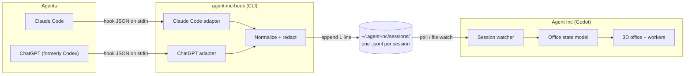

# Architecture

This doc explains how Agent Inc turns agent activity into an animated office. It is a design document: parts of it will change as the MVP is built.

## Design principles

1. **Zero tokens.** The game never talks to the model. Hooks run outside the model's context, and our hook prints nothing, so nothing is added to the conversation.
2. **Never slow the agent.** Hooks are registered as `async` wherever the agent supports it. The forwarder does one small file append and exits in milliseconds.
3. **Fail silently.** If the game is closed, crashed or not installed, the agent behaves exactly as before. The forwarder always exits with code `0`.
4. **Local only.** Events go to files on your disk. Nothing is sent over the network.
5. **Minimum data.** The forwarder keeps metadata, never content. See [Privacy](privacy.md).
6. **Agent-agnostic core.** Each agent has a small adapter that maps its hooks to one shared event format. The game only understands that format.

## Components



| Component | Tech | Responsibility |
| --- | --- | --- |
| `agent-inc-hook` | .NET 10 console app, Native AOT (a single small file that starts in milliseconds; built per OS) | Reads a hook payload from stdin, maps it to a normalized event, drops sensitive fields, appends one line to the session file, then exits `0` with no output. |
| Session files | JSON Lines (`.jsonl`) | A durable, append-only log, one file per agent session. They work whether or not the game is running. |
| Session watcher | C# in Godot | Detects new or changed session files and reads only the newly appended lines. |
| Office state model | C# in Godot | Turns the event stream into worker states: who is in the office, what each worker is doing, and who needs attention. |
| Office view | Godot 3D scenes | Desks, workers, animations, notifications and mini-games. |

### Why files instead of a network socket?

- **Works when the game is closed.** Events are buffered on disk, so opening the game later shows sessions that are still running.
- **No ports.** No firewall prompts, no port clashes, and nothing listening on the network.
- **One transport for every agent.** Claude Code supports HTTP hooks, but ChatGPT only supports command hooks. A command that appends to a file works for both.
- **Easy to debug.** You can `tail -f` a session file and see exactly what the game sees.

Each session gets its own file, so concurrent sessions never write to the same file.

## Code layout

```
agent-inc/
├── art/           # Blender scripts that generate the game's models
├── docs/
├── game/          # The Godot project (.NET 10, one C# project)
├── forwarder/     # agent-inc-hook (separate program, runs outside Godot)
└── tests/
```

Godot compiles every `.cs` file under its project folder, and `.gdignore` doesn't change that, so non-game code lives outside `game/`. Inside `game/`, folders Godot doesn't need get a `.gdignore`.

```
game/
├── assets/
├── scenes/          # .tscn files
└── scripts/
    ├── domain/      # Data: sessions, workers, office state, the event format
    ├── events/      # Event bus and its messages
    └── systems/     # All logic, including scene node scripts
```

- **Systems never reference each other.** They only publish and subscribe to messages on the event bus, and read or write domain data.
- **The bus is a typed C# bus** (`Publish<T>` / `Subscribe<T>`). It delivers messages on the main thread; work on background threads, such as file watching, is queued onto the main thread.
- **Bus messages are not hook events.** Agent hook events are domain data. The bus only carries game messages, such as `WorkerAppeared` or `ToolStarted`.
- **One event format definition.** The forwarder compiles the event format file from `game/scripts/domain/` directly, so that file must not use Godot types.

## Data directory

| Platform | Default location |
| --- | --- |
| macOS / Linux | `~/.agent-inc/` |
| Windows | `%USERPROFILE%\.agent-inc\` |

You can override the location with the `AGENT_INC_HOME` environment variable. It must be visible to both the agent and the game.

```
~/.agent-inc/
├── bin/agent-inc-hook        # Copied here by the game, so hook configs keep a stable path
├── sessions/
│   ├── claude-code/<session_id>.jsonl
│   └── codex/<session_id>.jsonl
└── settings.json             # Game settings (future)
```

The game deletes session files older than 7 days by default. Session IDs are sanitized before they are used as file names.

## Event format (v1)

Each line in a session file is one JSON object:

```json
{
  "v": 1,
  "ts": "2026-11-03T15:04:05.123Z",
  "source": "claude-code",
  "session": "5973b6c0-1f2e-4c1a-9b7d-2a8e0f3c4d5e",
  "agent": null,
  "kind": "tool.start",
  "tool": "Bash",
  "call": "toolu_01AbCdEfGhIjKlMnOpQrStUv",
  "category": "run",
  "project": "my-app",
  "hook": "PreToolUse"
}
```

| Field | Type | Description |
| --- | --- | --- |
| `v` | int | Schema version. It goes up only on breaking changes. |
| `ts` | string | UTC timestamp (ISO 8601), set by the forwarder. |
| `source` | string | `claude-code` or `codex` (ChatGPT). |
| `session` | string | The agent's session ID. One session is one worker. |
| `agent` | string \| null | Subagent ID, or `null` for the main agent. A subagent is shown as an intern. |
| `kind` | string | The normalized event type (see the table below). |
| `tool` | string \| null | Tool name for `tool.*` events, such as `Bash` or `Edit`. |
| `call` | string \| null | Tool call ID (`tool_use_id`) for `tool.*` events. It links a tool's start and end. |
| `category` | string \| null | Tool category: `read`, `edit`, `run`, `web`, `delegate` or `other`. |
| `project` | string | Last folder name of the agent's working directory, used for room or team labels. The full path is never stored. |
| `hook` | string | The original hook event name, kept for debugging. |

Readers must ignore fields they don't recognize. That lets new fields be added without bumping `v`.

### Event kinds

| `kind` | Claude Code hook | ChatGPT hook | What you see in the office |
| --- | --- | --- | --- |
| `session.start` | `SessionStart` | `SessionStart` | Nothing yet. The worker walks in on its first `prompt` or `tool.*` event. |
| `prompt` | `UserPromptSubmit` | `UserPromptSubmit` | The worker gets a task card and starts working. |
| `tool.start` | `PreToolUse` | `PreToolUse` | An activity animation for the tool category (see below). |
| `tool.end` | `PostToolUse` | `PostToolUse` | The activity finishes. |
| `tool.error` | `PostToolUseFailure` | — | A short frustrated reaction. |
| `attention` | `PermissionRequest`, `Notification` | `PermissionRequest`, or `PreToolUse` for the `request_permissions` tool | The worker raises a hand and the desk lamp blinks. |
| `turn.end` | `Stop` | `Stop` | The worker leans back: done, waiting for you. |
| `interrupt` | — | `Interrupt` | The worker stops abruptly. |
| `subagent.start` | `SubagentStart` | `SubagentStart` | An intern shows up at the desk. |
| `subagent.end` | `SubagentStop` | `SubagentStop` | The intern leaves. |
| `compact` | `PreCompact` | `PreCompact` | The worker tidies the desk and files paperwork. |
| `session.end` | `SessionEnd` | `SessionEnd` | The worker packs up and leaves. |

### Tool categories

Tool names are mapped to a small set of categories, and each category has its own animation. Unknown tools fall back to `other`, so new tools never break the game.

| `category` | Example tools | Animation idea |
| --- | --- | --- |
| `read` | `Read`, `Grep`, `Glob` | Browses the bookshelf or flips through files |
| `edit` | `Edit`, `Write`, `apply_patch` | Types fast at the desk |
| `run` | `Bash` | Works at the terminal or server rack |
| `web` | `WebFetch`, `WebSearch` | Looks at the big screen |
| `delegate` | `Task`, `Agent`, `collaborationspawn_agent` | Hands a folder to an intern |
| `other` | MCP tools and anything else | Generic "busy" animation |

## Office state model

The game rebuilds the office entirely from events, so it can be restarted at any time:

- **Worker per session:** appears on the session's first `prompt` or `tool.*` event. Sessions with neither, such as idle editor sessions, are never shown.
- **Activity:** set by `tool.start`, and cleared by the `tool.end` or `tool.error` with the same `call`, or by `turn.end`. Async hooks can arrive out of order, so events are matched by `call`, not by arrival order.
- **Interns:** Claude Code subagent tool calls carry `agent`, so interns show activity. ChatGPT subagents only send start and stop events.
- **Needs attention:** set by `attention` and cleared by the next event from the same session.
- **Stale sessions:** an agent may crash without sending `session.end`. If a session has had no events for 30 minutes, the worker goes idle. After 2 hours, the worker leaves. Both thresholds can be configured.
- **Projects:** a worker's `project` comes from its first event and doesn't change, even when the agent changes directory. Workers with the same `project` sit together.

## Future: talking back

Chatting with agents or controlling them from the game is planned but not designed yet. Possible routes include answering `PermissionRequest` hooks from the game (this would have to be synchronous and opt-in), or starting agents in headless or server modes that accept input. Any such feature will be **opt-in** and off by default, and it must not change the zero-token, no-slowdown behavior of the observe-only mode.
